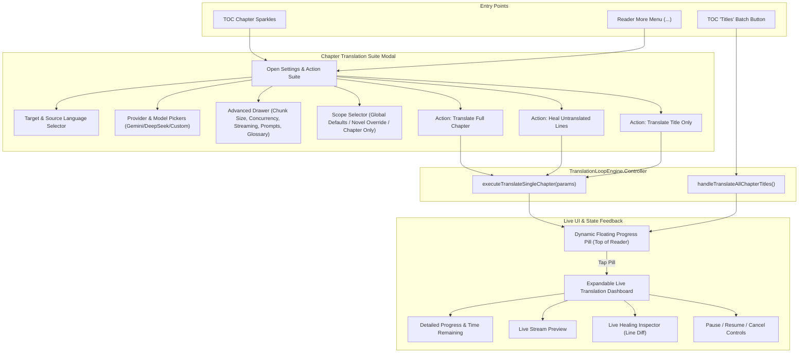

# Technical Architecture & Implementation Plan: Chapter & Title Translator Upgrade

> **Purpose of this Document**:  
> This document is a complete, self-contained architectural review and implementation plan for upgrading the **Chapter and Title Translator** in an existing production application. It contains all background context, technical constraints, problem statements, user requirements, and proposed code changes so that any external AI or senior software engineer can review it with **zero prior context** and provide rigorous critical feedback.

---

## 1. Executive Summary & Application Context

### 1.1 What the Application Does
The application is a **Client-Side Web / PWA / Android Hybrid Novel Reader & Translator** (Zero-Backend / Local-First).
- Users import foreign web novels (from web scrapers, EPUBs, text files, or clipboard).
- The app parses the book into structured chapters and stores everything locally in **IndexedDB** (`window.GeminiNovelDB`).
- Users read novels inside a built-in reading interface (with paginated and continuous scroll modes, Table of Contents, themes, and Text-to-Speech), and can translate chapters or compile full offline EPUB / PDF / DOCX books.
- Translations are powered by multi-provider AI APIs: **Google Gemini**, **DeepSeek**, **OpenAI**, **Anthropic Claude**, **DeepL**, and **LibreTranslate**, using user-provided API keys stored safely on device.

### 1.2 Technology Stack & Production Constraints
Any proposed implementation must strictly adhere to the project's production engineering rules:
1. **Zero-Build Browser Architecture**:
   - Runs directly in browsers and Android WebView without Webpack, Vite, Rollup, or Babel.
   - Plain Vanilla JavaScript (UMD / IIFE pattern) attaching modules to `window`.
   - **No `import` / `export` statements** or Node.js `require()` calls in browser code.
2. **React 18 UMD (No JSX)**:
   - UI components use `React.createElement` or the shorthand `h()`.
   - No JSX syntax in browser scripts.
3. **Anti-Bloat File Ceilings (Hard Limit: 3,000 Lines)**:
   - No single JavaScript file may exceed 3,000 lines. Existing files are:
     - `translation_loop_engine.js` (~2,910 lines)
     - `reader_engine.js` (~2,740 lines)
     - `reader_ui_modals.js` (~1,530 lines)
     - `utils.js` (~1,875 lines)
     - `app.js` (~2,878 lines)
   - Code additions must be modular, concise, and reuse existing central helpers to avoid hitting line caps.
4. **Single Source of Truth**:
   - `window.GeminiNovelDB` (IndexedDB) is the sole store of novel chapters, translation state, and reading progress. `localStorage` is only for light UI preferences.
5. **Defensive Async & Error Handling**:
   - All async AI calls and database updates must be wrapped in `try / catch` with logging to `window.AppLogger`.
   - All long-running translation tasks must hold native screen wake locks (`window.NativeBridge?.acquireWakeLock()`) and attach `AbortController` signals.
6. **Strict Synchronized Version Management**:
   - Version number must be bumped and synchronized across 6 files simultaneously: `package.json`, `app.js`, `sw.js`, `index.html` (all script query strings), `version.json`, and `android/app/build.gradle`.

---

## 2. The Problem Statement

### 2.1 Where Chapter & Title Translation Occurs
Users can trigger translation from three places:
1. **Reader Table of Contents (TOC) Drawer**: Tapping the "Sparkles" button next to any chapter opens an action menu.
2. **Reader More Menu (`···`)**: Selecting "Translate This Chapter" or "Translate Chapter Title Only".
3. **TOC Drawer Batch Action**: Clicking the "Titles" button to batch-translate all chapter titles in the book.

### 2.2 Key Deficiencies in the Current System
1. **Zero Settings Control**:
   - When tapping "Translate Full Chapter", "Heal Untranslated Lines", or "Translate Title", the app immediately launches the request using global memory defaults.
   - The user **cannot** change or even inspect:
     - Target language (e.g. translating into Spanish, French, German, or Japanese).
     - AI Provider or AI Model (e.g. switching between Gemini 3.7 Flash, DeepSeek Chat, Reasoner, or a custom model).
     - Concurrency (speed / rate limit control) or Chunk Size (Turbo vs Balanced).
     - Streaming & Deep Thinking toggles.
     - Glossary profiles or custom styling prompts.
   - *In contrast, the app's main translator tab (`TabTranslate`) provides full control over all of these.*
2. **Poor & Unresponsive Progress Bar**:
   - In-reader chapter translation shows a static, tiny 60px wide by 4px high progress bar at the top of the screen.
   - It cannot be tapped or expanded.
   - There is no Pause or Stop/Cancel button.
3. **Invisible Batch Title Progress**:
   - Translating all titles only changes a small text label inside the TOC drawer (`Titles (12/50)`).
   - If the user closes the drawer to continue reading, there is zero progress feedback.
   - There is no Cancel/Stop button to safely stop title translation without losing already-translated titles.
4. **Flawed & Opaque "Healing" Engine**:
   - "Healing" is designed to scan an already-translated chapter for missed untranslated lines or API error placeholders (`[Error: ...]`) and translate only those lines to save tokens.
   - **Bug A (Language Blindness)**: It checks exclusively for CJK characters (`\u3400-\u9fff`), so novels in Cyrillic/Russian, Thai, Arabic, Vietnamese, or European languages are completely ignored.
   - **Bug B (Hardcoded Target)**: The healing prompt hardcodes instructions to "Translate accurately into English", corrupting books being translated into Spanish, French, German, etc.
   - **Bug C (AI Pollution)**: If the AI wraps its response in markdown fences (````markdown ... ````) or prepends conversational text ("Here is the translation:"), that text is directly spliced into the book's chapter prose.
   - **Bug D (Zero Transparency)**: The user has no idea which lines were detected or what is being healed.

---

## 3. User Requirements & Design Decisions

Through an interactive design interview, the user established the following preferences:
1. **All-in-One Settings Suite**:
   - Tapping the chapter translation button must open a full settings panel with **all** controls from the main translator: Provider, Model, Custom Model, Target Language, Concurrency, Chunk Size, Streaming, Thinking, Glossaries, and Custom Prompts.
2. **Dynamic Floating Progress Pill**:
   - A prominent floating pill at the top of the reader showing real-time chapter info, animated gradient progress bar, percentage, chunk step ("Chunk 2/5"), and an instant Stop button.
3. **Expandable Live Translation Dashboard**:
   - Tapping the progress pill expands a comprehensive dashboard modal with live text streaming preview, token count, estimated time remaining, and full Pause, Resume, and Cancel controls.
4. **Live Healing Inspector**:
   - When healing, the dashboard must display the exact detected untranslated paragraphs (line numbers, foreign text snippet, and healed translated result) in real time.
5. **Persistence Scope Flexibility**:
   - By default, settings sync bidirectionally with the main translator defaults.
   - Users can optionally toggle "Remember for this novel only" or "Apply for this chapter only".
6. **Unified Batch Title Translation**:
   - Translating all chapter titles connects to the same Dynamic Pill & Dashboard, showing live title progress with a Stop button.

---

## 4. Architectural Design & System Flow



---

## 5. Detailed Component Implementation Plan

### Component 1: `reader_ui_modals.js` — Chapter Translation Suite Modal
Upgrade the existing lightweight `actionMenuChap` popup into a full-featured configuration suite.

```javascript
// State structure inside ReaderTocDrawer / ReaderEngine
const [chapModalTab, setChapModalTab] = useState('actions'); // 'actions' | 'settings'
const [chapProvider, setChapProvider] = useState(() => localStorage.getItem('translation_provider') || 'gemini');
const [chapModel, setChapModel] = useState(() => localStorage.getItem('geminiModel') || 'gemini-3.7-flash');
const [chapCustomModel, setChapCustomModel] = useState(() => localStorage.getItem('customModel') || '');
const [chapUseCustomModel, setChapUseCustomModel] = useState(() => localStorage.getItem('useCustomModel') === 'true');
const [chapTgtLang, setChapTgtLang] = useState(() => localStorage.getItem('tgtLang') || 'English');
const [chapConcurrency, setChapConcurrency] = useState(() => parseInt(localStorage.getItem('concurrency') || '2', 10));
const [chapChunkSize, setChapChunkSize] = useState(() => localStorage.getItem('chunkSizePreset') || 'turbo');
const [chapStreaming, setChapStreaming] = useState(() => localStorage.getItem('enableStreaming') !== 'false');
const [chapThinking, setChapThinking] = useState(() => localStorage.getItem('enableThinking') === 'true');
const [chapScope, setChapScope] = useState('global'); // 'global' | 'novel' | 'chapter'
const [chapInstructions, setChapInstructions] = useState(() => localStorage.getItem('customInstructions') || '');
```

**UI Sections in the Modal**:
1. **Chapter Header**: Cleaned chapter title (`window.cleanRawChapterTitle`), chapter number, and word count.
2. **Primary Execution Buttons**:
   - `Translate Full Chapter`
   - `Heal Untranslated Lines Only (Save Tokens)`
   - `Translate Title Only`
3. **Quick Settings Bar**:
   - Target Language Dropdown (all standard languages).
   - AI Provider Selector (Gemini, DeepSeek, OpenAI, Claude, DeepL, LibreTranslate).
   - Model Selector (with custom model toggle).
4. **Expandable "More Controls" Drawer**:
   - Concurrency (1–5) and Chunk Size presets (Turbo / Balanced / Large).
   - Streaming & Deep Thinking switches.
   - Active Glossary Profile selection.
   - Custom style prompt textarea with quick preset buttons (Literary, Dialogue, Web Novel).
5. **Persistence Scope Switcher**:
   - `Save as App Default` (syncs with `localStorage`).
   - `Save for this Novel Only` (persisted into `novelRecord.translationSettings` in `GeminiNovelDB`).
   - `Apply for this Chapter Only` (ephemeral).

---

### Component 2: `reader_engine.js` — Dynamic Floating Pill & Live Translation Dashboard

#### 2.1 Dynamic Floating Progress Pill
Replaces the static 60px mini-bar with an interactive floating component:
- **Position**: Pinned at top center (`top: 54px`, `z-index: 10002`).
- **Visuals**:
  - Pulsing sparkle/activity icon.
  - Chapter / task label: `Ch. 5: [Clean Title]` or `Translating Titles: 14/50`.
  - Gradient progress bar (`width: 140px`, height `6px`, animated stripes).
  - Percent badge (`45%`) & step text (`Chunk 2/5`).
  - Integrated red `Stop` button (`ic('Square', 12)`) to abort immediately.
- **Click Action**: Clicking anywhere on the pill (except the Stop button) sets `setIsDashboardOpen(true)`.

#### 2.2 Expandable Live Translation Dashboard Modal
Renders when `isDashboardOpen` is true while a translation is active:
- **Header**:
  - Task title, active chapter, and current AI model pill (`Gemini 3.7 Flash · Turbo`).
  - Minimize button (collapses back to pill) and Cancel button.
- **Progress Gauge**:
  - Full-width percentage bar with chunk tracker (`2 of 5 chunks completed`).
  - Real-time elapsed time timer (`00:24`) and estimated remaining time.
- **Live Text Stream View**:
  - Displays streaming tokens in real time as the AI generates paragraphs.
- **Live Healing Inspector (when Healing is active)**:
  - Table / cards of detected untranslated paragraphs:
    - `#`: Paragraph number in the chapter.
    - `Original`: Snippet of the foreign text detected.
    - `Status`: Badge (`Scanning`, `Healing...`, `Healed ✓`).
    - `Healed Output`: The sanitized translated text snippet.
- **Action Toolbar**:
  - `Pause / Resume` button.
  - `Stop Translation` button (aborts request, safely writes completed chunks).
  - `Collapse to Pill` button.

---

### Component 3: `translation_loop_engine.js` — Multi-Language Healing & Options Overrides

#### 3.1 Multi-Language Untranslated Detector
Replace CJK-only regex with a dynamic script detector:
```javascript
const targetLanguage = opts.tgtLang || config.tgtLang || 'English';

const hasUntranslatedOrError = (p) => {
  if (!p || typeof p !== 'string') return false;
  // Always flag error blocks from previous aborted/failed runs
  if (/\[Error:.*?\]/i.test(p)) return true;
  // CJK characters (Chinese / Japanese Kanji & Kana)
  if (/[\u3040-\u30ff\u3400-\u4dbf\u4e00-\u9fff\uf900-\ufaff]/.test(p)) return true;
  // Korean Hangul
  if (/[\uac00-\ud7af]/.test(p)) return true;
  // Cyrillic script (unless target is Russian/Ukrainian/Bulgarian/Serbian)
  if (!/^(?:Russian|Ukrainian|Bulgarian|Serbian|Cyrillic)/i.test(targetLanguage) && /[\u0400-\u04ff]/.test(p)) return true;
  // Thai script (unless target is Thai)
  if (!/^Thai/i.test(targetLanguage) && /[\u0e00-\u0e7f]/.test(p)) return true;
  // Arabic script (unless target is Arabic)
  if (!/^Arabic/i.test(targetLanguage) && /[\u0600-\u06ff]/.test(p)) return true;
  return false;
};
```

#### 3.2 Prose Sanitization & Target Language Parameterization
```javascript
function cleanHealedProse(str) {
  if (!str) return '';
  let s = str.trim();
  // Strip markdown code fences if output by the model
  s = s.replace(/^```[a-z]*\s*\n?/i, '').replace(/\n?```\s*$/i, '');
  // Strip conversational assistant intros
  s = s.replace(/^(?:Here(?:\s+is|\s*'s)?\s+(?:the\s+)?translation[:\s]*|Translation[:\s]*)/i, '');
  return s.trim();
}

// In healing loop:
const healInstructions = opts.instructions || config.instructions ||
  `Translate accurately and fluently into ${targetLanguage}. Maintain formal novel prose style and preserve all quotes, indentation, and formatting. Output ONLY the translated prose, without commentary or markdown code fences.`;
```

#### 3.3 Streaming & Healing Progress Callbacks
Expose callbacks in `executeTranslateSingleChapter`:
- `onStreamChunk({ chunkIdx, totalChunks, chunkText })`: feeds live stream preview in the dashboard.
- `onHealingScanned(blocks)`: notifies dashboard of detected lines.
- `onHealingBlockProgress({ blockIdx, totalBlocks, originalSnippet, healedSnippet, status })`: updates the Live Healing Inspector.

---

### Component 4: Batch Title Translation Integration
In `reader_engine.js`:
- `handleTranslateAllChapterTitles`:
  - Instantiates an `AbortController`.
  - Sets active batch state: `{ isActive: true, done: 0, total: N, currentTitle: '...', abortController }`.
  - Displays the Dynamic Floating Pill with live counts.
  - Tapping Stop triggers `abortController.abort()` and saves all titles completed up to that point.

---

## 6. Edge Cases & Resilience Strategy

| Edge Case | Risk | Mitigation |
| :--- | :--- | :--- |
| **User cancels mid-translation** | Corrupted chapter or lost progress | AbortController halts network immediately; already-completed chunks are assembled and committed to `GeminiNovelDB`. |
| **Entire chapter is untranslated when user clicks "Heal"** | Sending giant single block to API, hitting token limits | If detected untranslated paragraphs $> 85\%$ of chapter, automatically routes through standard chunked translation loop instead of single-shot block replacement. |
| **Model returns markdown fences in healing** | ` ``` ` characters appear inside reader text | `cleanHealedProse` automatically strips opening/closing code blocks and conversational prefixes before splicing. |
| **User switches apps on mobile during translation** | Android WebView pauses background timers/network | Wake lock held via `NativeBridge.acquireWakeLock()`; continuous background audio buffer keep-alive active. |
| **Custom model is invalid or deleted** | API returns 404, chapter translation stalls | Engine falls back gracefully to `Gemini 3.7 Flash` with error toast and logs to `AppLogger`. |
| **File line count limit** | Exceeding 3,000 lines violates Rule 2.7 | New UI sub-components are placed in `reader_ui_modals.js` (~1,530 lines) where there is 1,400+ lines of headroom. |

---

## 7. Verification & Testing Strategy

1. **Syntax Check**:
   - `node --check reader_ui_modals.js`
   - `node --check reader_engine.js`
   - `node --check translation_loop_engine.js`
   - `node --check utils.js`
   - `node --check app.js`
2. **Headless In-Memory Simulation**:
   - Run `node scratch/simulate_app.js` to verify `App()` mounts cleanly with zero reference errors.
3. **Tab Props Audit**:
   - Run `node scratch/audit_tab_props.js` to ensure 100% prop parity between components.
4. **Capacitor Mobile Sync**:
   - Run `npm run cap:sync` to verify Android assets compile without syntax drift.

---

## 8. Review Questions for External AI Evaluator

Please evaluate this plan against the following criteria:
1. **Architectural Cohesion**: Does the integration between `reader_ui_modals.js`, `reader_engine.js`, and `translation_loop_engine.js` follow clean separation of concerns without introducing state drift?
2. **User Experience**: Is the two-tier progress display (Dynamic Pill $\rightarrow$ Expandable Live Dashboard) intuitive and non-intrusive for reading?
3. **Healing Algorithm Robustness**: Does the multi-language detection and paragraph replacement algorithm adequately prevent text misalignment and commentary leakage?
4. **Constraint Compliance**: Does the plan respect all zero-build (pure UMD JS, React 18 `createElement`, no bundler) and anti-bloat (< 3,000 line) constraints?
5. **Edge Cases**: Are there any overlooked failure modes when translating individual chapters or titles in a mobile WebView environment?
